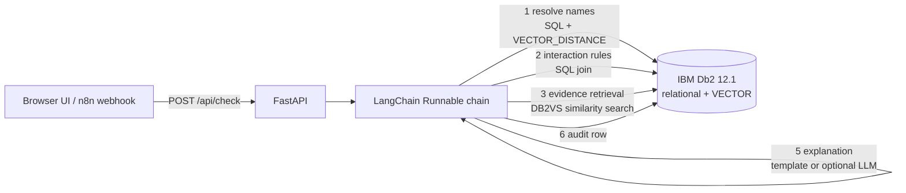

# HerbCheck on IBM Db2

**Herb–drug interaction reference that uses IBM Db2 12.1 as its knowledge base, vector store and audit trail, orchestrated with LangChain.**
A research demo by Uday Shankar Bhowal (LearnHive Labs). Open source (MIT). Synthetic, **unreviewed** reference data.

> **Educational reference only. Not medical advice, not a medical device.** The reference set (`data/interaction_kb.json`, v0.1.0-starter) has not been pharmacist-reviewed. "No result" means "not found in this set", never "safe". No user data is stored.

## Problem

People mix herbal products (ginkgo, St John's wort, ginger, turmeric...) with prescription drugs, and clinically relevant interactions are scattered across sources. A good reference must be **explainable** (show the rule and the evidence), **cautious** (never guess), and **auditable**.

## What Db2 does here (the core of the project)

| Db2 capability | How it is used |
|---|---|
| Relational model, constraints, FK cascade, CHECK, index | `HERBS`, `DRUGS`, `DRUG_CLASSES`, `INTERACTION_RULES`, `RULE_CLASSES`, aliases and class membership (`sql/schema.sql`) |
| SQL joins | One join returns every rule of a herb that applies to the drug classes of all the user's medications (`Db2Repo.rules`) |
| **`VECTOR(384, FLOAT32)` columns + `VECTOR_DISTANCE(..., COSINE)`** | "Did you mean" for misspelled herb and drug names, computed inside Db2 (`Db2Repo.nearest`) |
| **LangChain `DB2VS` vector store** (`langchain-db2`) | Evidence passages for each rule are embedded and retrieved with Db2 similarity search (RAG context shown next to each finding) |
| View with `LISTAGG` | `V_RULE_OVERVIEW` for browsing rules by herb |
| Identity column + audit table | `CHECK_LOG` records counts and a one-way digest of every check, never the raw medication or herb names |

## Architecture



Pipeline stages (each is a `RunnableLambda`, timed and returned in the response): `normalize -> resolve_db2 -> interactions_db2_sql -> evidence_db2_vector -> gate -> explain -> audit_db2`.

**Safety design**
- A misspelled name is only *suggested* ("did you mean"), never auto-accepted.
- Status is `delivered` only if every herb and medication was recognized and every finding has confidence >= 0.80; otherwise `needs_review` with the reasons.
- The optional LLM can only rephrase the retrieved findings (temperature 0, "use only these facts"); it is off by default and the app works fully without it.

## Quick start (about 10 minutes)

Works in GitHub Codespaces or any machine with Docker (about 4 GB RAM free) and Python 3.10+.

```bash
# 1. Start Db2 Community Edition (free). First run downloads ~2 GB and takes 5-10 min.
bash scripts/setup_env.sh        # creates .env with a random Db2 password
docker compose up -d
docker compose logs -f db2      # wait for "Setup has completed", then Ctrl+C

# 2. Install and load the data
python -m venv .venv && source .venv/bin/activate
pip install -r requirements.txt
pip install -r requirements-extra.txt   # optional: real semantic embeddings (falls back automatically if it fails)
python -m app.ingest --reset

# 3. Run
uvicorn app.api:app --host 0.0.0.0 --port 8000
# open http://localhost:8000  (in Codespaces: the "Ports" tab -> open port 8000)

# 4. Test
scripts/smoke_test.sh
pip install -r requirements-dev.txt && pytest      # 17 offline tests, no Db2 needed
```

Without Docker you can point the app at any Db2 12.1.2+ (including IBM Db2 SaaS) through the `DB2_*` variables in `.env`.

## API

`POST /api/check` with `{"medications": ["warfarin"], "herbs": ["ginkgo"]}` (max 6 medications, 5 herbs, 60 characters each) returns status, findings (attention level, evidence type, confidence, mechanism, matched drug classes, Db2 evidence passages with vector distance), unrecognized names with suggestions, an explanation, and Db2 version and per-stage timings.
`GET /api/health`, `GET /api/stats` (live counts and audit totals read from Db2).

## n8n front door (optional)

`n8n/herbcheck-db2-front-door.workflow.json`: Webhook -> HTTP Request to this API -> Respond. Import it in n8n and set `HERBCHECK_DB2_API_URL` (or edit the URL in the HTTP node). This is how the same Db2 knowledge base can serve automations and a future frontend.

## Repository layout

```
app/        chain.py (LangChain pipeline), repo.py (all Db2 access), ingest.py, api.py, embeddings.py, static/index.html
sql/        schema.sql
data/       interaction_kb.json (25 herbs, 21 drug classes, 160 drugs, 44 rules; unreviewed starter)
tests/      17 tests; tests/memory_repo.py swaps Db2 for an in-memory repo
n8n/        optional workflow
```

## Limits and honesty

- Reference set is a small unreviewed starter, not a clinical product. It needs pharmacist review before any real-world use.
- Drugs are matched by name to a class list; brand names and combination products are mostly not covered.
- Synthetic/demo only: do not enter real patient data.
- DB2VS applies metadata filters after the top-k search, so retrieval over-fetches (k=50) and filters by herb.

## Credits

IBM Db2 Community Edition, `langchain-db2`, LangChain, FastAPI, optional FastEmbed (BAAI/bge-small-en-v1.5). MIT license.
